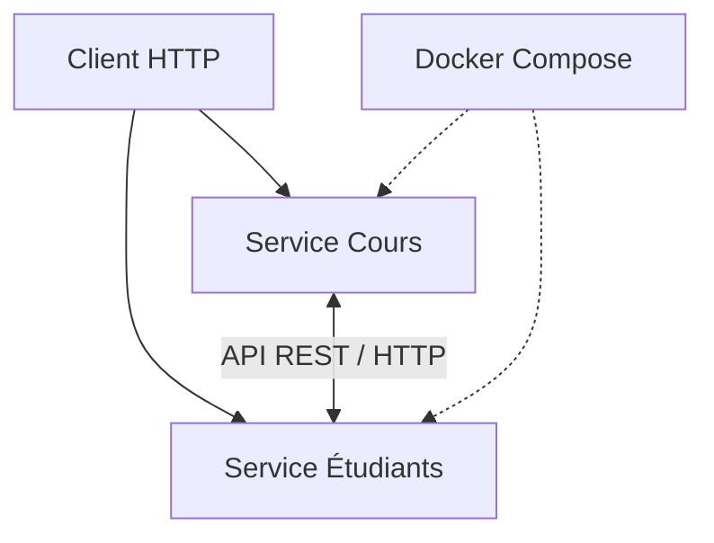
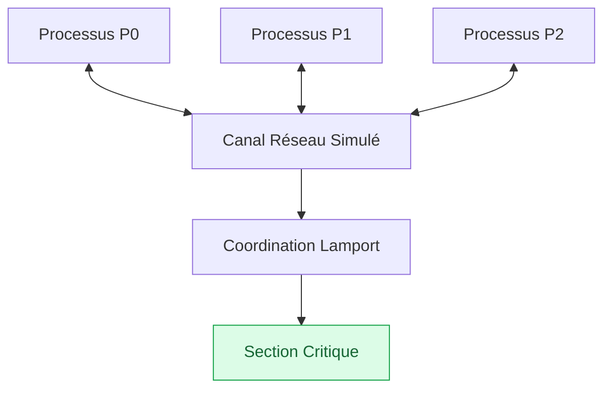

 <div align="center">

# 🌐 Architecture Distribuée & Cloud Computing

### Travaux Pratiques — Java, Spring Boot & Systèmes Distribués

**Collection des travaux pratiques réalisés dans le cadre du module Architecture Distribuée et Cloud Computing.**


---

**TP2 — API REST & Microservices** | **TP3 — Coordination & Lamport** | **TP4 — À venir**

</div>

## 📖 À propos du projet

Ce dépôt regroupe les travaux pratiques du module **Architecture Distribuée et Cloud Computing**.

L'objectif principal est de comprendre, concevoir et expérimenter des systèmes distribués à travers des implémentations pratiques.

Les sujets abordés comprennent :

- Les architectures client-serveur et microservices.
- La communication entre services via API REST.
- La conteneurisation avec Docker.
- La coordination et la synchronisation des processus.
- Les horloges logiques de Lamport.
- L'exclusion mutuelle distribuée.
- La simulation réseau et la tolérance aux pannes.
- L'analyse des performances des systèmes distribués.

## 🗂️ Structure du repository

```text
Architecture-Distribuee_Ismail_Marouane/
│
├── 📁 TP2/
│   ├── ServiceEtudiants/
│   ├── ServiceCours/
│   └── compose.yaml
│
├── 📁 TP3/
│   ├── src/
│   │   └── main/java/org/example/
│   │       ├── LamportExclusion.java
│   │       └── LamportDistributedMutex.java
│   ├── pom.xml
│   └── lamport_resultats.csv
│
├── 📄 README.md
└── 📄 .gitignore
```

---

## 🚀 TP2 — API REST Distribuée avec Spring Boot


### 🎯 Objectif

Mettre en place une architecture distribuée composée de deux services indépendants communiquant à travers des API REST.

### 🏗️ Architecture



### ⚙️ Technologies utilisées

| Technologie | Rôle |
|---|---|
| Java | Développement des services |
| Spring Boot | Création des API REST |
| Maven | Gestion du projet |
| Docker | Conteneurisation |
| Docker Compose | Orchestration locale des services |
| HTTP / JSON | Communication entre services |

### ▶️ Exécution

```bash
cd TP2
docker compose up --build
```

Pour arrêter les services :

```bash
docker compose down
```

📂 **[Consulter le TP2](./TP2)**

---

## 🔐 TP3 — Coordination et Cohérence dans les Systèmes Distribués


### 🎯 Objectif

Comprendre et implémenter les mécanismes de coordination et d'exclusion mutuelle dans les systèmes distribués à l'aide des horloges logiques de Lamport.

### Partie A — Exclusion Mutuelle avec Lamport

**Fichier :** `LamportExclusion.java`

Simulation de trois processus Java qui souhaitent accéder à une ressource partagée appelée **Section Critique (SC)**.

Concepts abordés :

- Horloge logique de Lamport.
- Threads Java.
- Messages REQUEST, REPLY et RELEASE.
- File d'attente des requêtes.
- Exclusion mutuelle.

### Partie B — Exclusion Mutuelle Distribuée et Simulation Réseau

**Fichier :** `LamportDistributedMutex.java`

Extension de la Partie A avec une simulation réseau plus avancée.

**Fonctionnalités :**

| Fonctionnalité | Description |
|---|---|
| 🌐 Canal réseau | Transmission des messages avec délais aléatoires |
| ⚠️ Pannes | Simulation de défaillance d'un processus |
| 📨 Messages | Comptage des messages échangés |
| 📋 File d'attente | Visualisation des demandes d'accès |
| ⏱️ Performance | Mesure du temps moyen d'attente |
| 📉 Perte réseau | Simulation de perte de messages |

### 🏗️ Architecture de simulation



### ▶️ Compilation et exécution

Depuis le dossier TP3 :

```bash
cd TP3
mvn compile
```

**Partie A :**

```bash
java -cp target/classes org.example.LamportExclusion
```

**Partie B :**

```bash
java -cp target/classes org.example.LamportDistributedMutex --n 3 --perte 0 --panne 0 --duree 12
```

### 🧪 Expérimentations

**Simulation sans perte ni panne :**

```bash
java -cp target/classes org.example.LamportDistributedMutex --n 3 --perte 0 --panne 0 --duree 12
```

**Simulation avec 30 % de perte de messages :**

```bash
java -cp target/classes org.example.LamportDistributedMutex --n 3 --perte 30 --panne 0 --duree 12
```

**Simulation avec panne :**

```bash
java -cp target/classes org.example.LamportDistributedMutex --n 3 --perte 0 --panne 100 --duree 18
```

### 📊 Analyse des performances

Les résultats des simulations sont enregistrés dans :

`TP3/lamport_resultats.csv`

Les indicateurs étudiés comprennent :

- Nombre de processus.
- Messages envoyés, livrés et perdus.
- Nombre d'entrées en section critique.
- Temps moyen d'attente.
- Impact des délais et des pannes.

**Observation :** une augmentation du nombre de processus entraîne généralement davantage de messages de coordination. La perte de messages et les défaillances peuvent empêcher la progression du système.

📂 **[Consulter le TP3](./TP3)**

---

## 📌 Suivi des travaux pratiques

| TP | Sujet | État |
|---|---|---|
| TP2 | API REST Distribuée — Spring Boot & Docker | ✅ Réalisé |
| TP3 | Coordination et Exclusion Mutuelle — Lamport | ✅ Implémenté |
| TP4 | Prochain travail pratique | ⏳ À venir |
| TP5 | Prochain travail pratique | ⏳ À venir |

---

## 🧠 Compétences développées

- Conception d'architectures distribuées.
- Développement de services REST.
- Communication interservices.
- Utilisation de Docker et Docker Compose.
- Programmation concurrente en Java.
- Synchronisation par horloges logiques.
- Analyse des performances et des défaillances.

---

## 👨‍💻 Réalisé par

**Ismail & Marouane**

Projet académique — Module Architecture Distribuée et Cloud Computing.

<div align="center">

---

**Développé dans un cadre pédagogique pour approfondir les concepts des systèmes distribués.**

⭐ *Merci de votre visite !*

</div>
